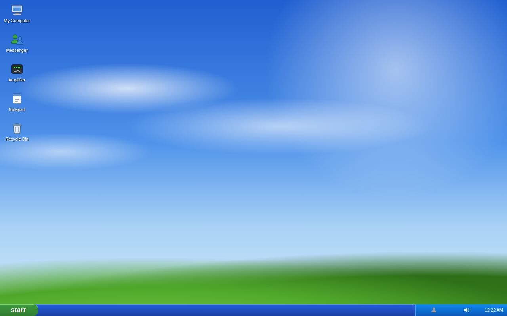
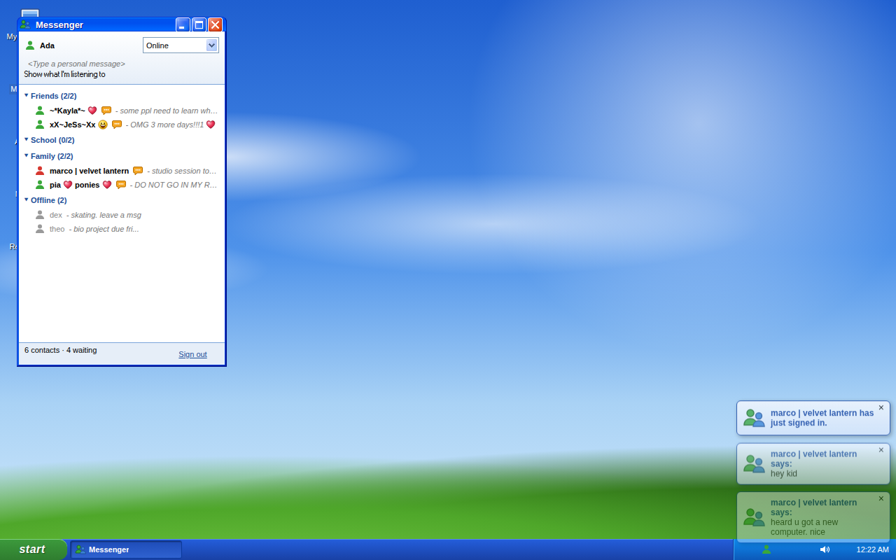
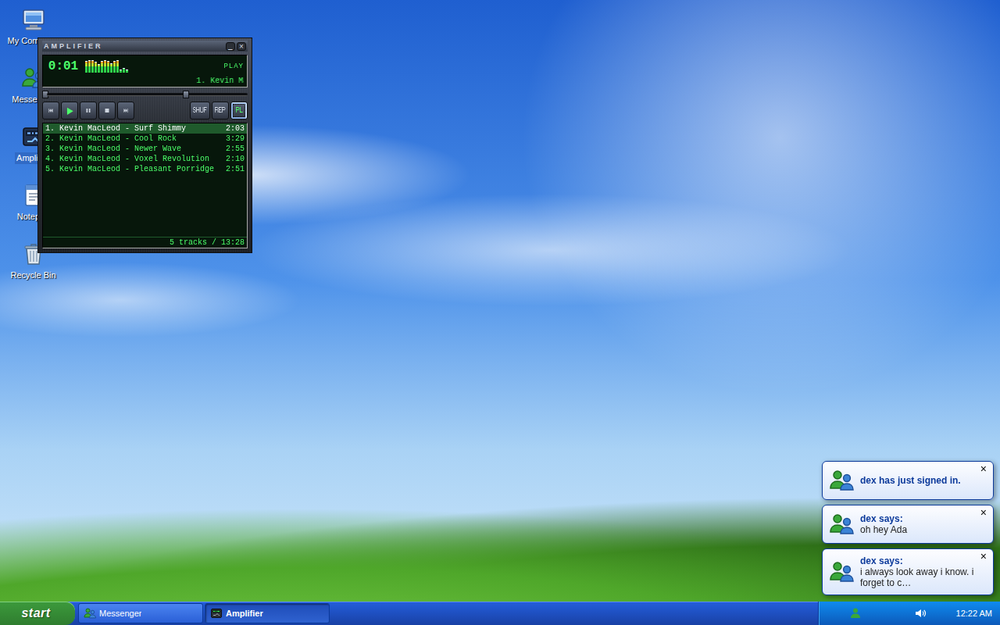

# still-online

A browser-based nostalgia simulator recreating Windows XP and the social internet of 2007 through MSN, Netlog, MySpace, Winamp, and a living fictional desktop.

> **v0.1 — playable MVP.** Play it now: **<https://drilonrecica.github.io/still-online/>**



## About

Remember coming home from school, hearing the XP startup sound, and waiting for MSN to sign in so you could see who was online? **still-online** is an attempt to bring that moment back: a Windows XP–style desktop that runs entirely in your browser, frozen somewhere in 2007.

It isn't meant to be a static museum piece. The desktop is meant to feel *lived in*. A cast of fictional friends sends you messages, updates their profiles, changes their status lines and leaves comments while you're away. You're logging back into an internet that kept going without you.

## What's in it

- **Windows XP–style desktop**: boot and login screens, start menu, taskbar, draggable and resizable windows, desktop icons and an original wallpaper
- **Messenger**: an MSN-style client with six fictional friends, statuses, personal messages, emoticons, nudges, sign-in toasts and a "now playing" line. Conversations continue over time, and friends waiting for your reply are marked and flash in the taskbar
- **Amplifier**: a Winamp-style music player with an original skin, playlist, seek and volume, shuffle/repeat and a visualizer
- **Notepad** and the usual desktop furniture

| Messenger | Amplifier |
| --- | --- |
|  |  |

## Planned

These are not built yet:

- **Netlog / MySpace–style profiles**: customizable profile pages, friend lists, comments and profile songs
- **A living world**: fictional characters and events that change over time, so each visit feels a little different

## Run locally

```bash
nvm use        # Node version from .nvmrc
npm ci
npm run dev    # http://localhost:5173/still-online/
```

Other useful scripts: `npm run verify` (typecheck, lint, unit tests, build) and `npm run e2e` (Playwright; run `npx playwright install chromium` once).

## Tech stack

React 18, TypeScript, Vite, Zustand, [xp.css](https://botoxparty.github.io/XP.css/) for the window chrome, Vitest and Playwright. Everything runs client-side and is deployed to GitHub Pages. See [docs/architecture.md](docs/architecture.md) for how it fits together.

## Contributing

Ideas, memories, bug reports and feedback are very welcome. [Open an issue](https://github.com/drilonrecica/still-online/issues) to share them.

## Disclaimer

still-online is a fan-made, non-commercial nostalgia project. It is **not** affiliated with, endorsed by, or sponsored by Microsoft, MySpace, Netlog, Winamp, or any of their owners. All product names, logos and trademarks belong to their respective owners and are mentioned only to describe the era the project recreates. All characters, conversations and content inside the simulation are fictional.

## License

Licensed under the [Apache License 2.0](LICENSE).

Asset attributions are listed in [Credits](CREDITS.md).
