# still online

_everyone you knew, still online._

A browser-based nostalgia simulator recreating Windows XP and the social internet of 2007 through MSN, Netlog, MySpace, Winamp, and a living fictional desktop.

> **v0.6 — play on your phone or tablet.** The same desktop now works by touch, with the days 1–10 story from v0.5. Play it now: **<https://drilonrecica.github.io/still-online/>**


## About

Remember coming home from school, hearing the XP startup sound, and waiting for MSN to sign in so you could see who was online? **still online** is an attempt to bring that moment back: a Windows XP–style desktop that runs entirely in your browser, frozen somewhere in 2007.

It isn't meant to be a static museum piece. The desktop is meant to feel *lived in*. A cast of fictional friends sends you messages, updates their profiles, changes their status lines and leaves comments while you're away. You're logging back into an internet that kept going without you.

## What's in it

### Desktop

- **Windows XP–style shell**: boot and login screens, Start menu with an All Programs flyout, taskbar and tray (mute, network, clock), draggable/resizable windows, desktop icons you can drag into place (Arrange Icons By puts them back), synthesized system sounds
- **A world that moves on**: the in-game day advances after a shutdown or a new real date, and each day brings new chats, mail, guestbook entries and profile comments (days 1–10 are scripted, two school weeks ending with the Velvet Lantern show; later days keep the day-10 state)
- **User Accounts**: pick your name, a picture (eight to choose from) and whether you play as a **girl or a boy**. The friends, voices and story stay the same; what is addressed to or about you changes: files, favorites, chats, mail and a few sites. Switch any time, live
- **Display Properties**: thirteen procedurally drawn wallpapers (ten homages, two easter eggs and Theo's Velvet Lantern show poster, unlocked on day 10), Blue / Olive / Silver appearance, and screensavers (Pipes, Flying Panes, Marquee, My Pictures Slideshow)
- **Explorer**: My Documents, My Pictures and My Music on a persistent virtual file system, plus a Recycle Bin you can restore from. Pictures open in the **Picture Viewer** (previous/next, best fit or actual size, Edit in Paint)
- **Balloon tips**, a dial-up connection dialog with a synthesized modem handshake, and a **Disk Cleanup** that scans forever and frees nothing
- **Notepad** that opens and saves files in My Documents

### Messenger

- Six fictional friends with statuses, personal messages, emoticons (including your own, made from your pictures), nudges, winks, sign-in toasts and a "now playing" line
- **Week two (days 6–10)**: Marco's gig at the rec hall, Kayla's class rep election, Theo's poster, Jess's fan art contest, Pia's hamster and Dex's skate jam, each with girl-only and boy-only threads; the arcs meet on day 10, show night
- Conversations continue over days; friends react to the music you play and to your game scores
- Away messages with a "while you were away" summary, a per-contact **Message History** and display pictures from My Pictures

### Internet

- **Web Explorer** with history, favorites and a fully fictional, local web: **Searchly** (search over every page), a cursed 2003 fan page, a gossip blog, a school site and more
- **Friendspace** (a 2007 profile site): profiles for each friend and you, with a **Top 8** that reacts when you drop someone (they notice the next day, in Messenger and on your wall), **bulletins**, **band pages** with a player that hands tracks to the Amplifier, a profile song with autoplay, and a layout-code box
- **Pixlog** (a photo-sharing site): each friend's albums, blog, surveys and guestbook, a shouts feed, kudos, and your own page with an album built from your pictures, surveys to fill in and six skins
- **GlitterCodez**: twelve copy-and-paste layouts, glitter text, stickers and cursors; paste a code into your Friendspace profile and it restyles the page
- **CheatCave** and **Kickflip Kings** (the boy side of the web): cheats, flash-game news and a forum, and a skate crew site with a shoutbox and Velvet Lantern gigs. Every site is on both sides and findable through Searchly; the favorites and the front page follow who you are
- **Mail** with a new batch of messages per day: chain letters, spam, family and friends, with replies to what you send
- **TuneMole**, a fake peer-to-peer client with slow, jittery downloads that lands tracks in My Music and the Amplifier

### Creative

- **Paint**: classic tools, undo, open/save to My Pictures, set as wallpaper or display picture
- **Snapshot Booth**: webcam photos with filters, or a cartoon avatar if you have no camera. The webcam stays local: nothing is recorded or uploaded, and photos are saved only in this browser
- **Amplifier**: five CC BY tracks, three skins, windowshade mode, a ten-band equalizer, an editable playlist and a visualizer

### Games and extras

- **Mines**, **Hen Hunt** (a shooting gallery), **Star Pinball** and **Desktop Wrecker** (smash the desktop with a hammer, chainsaw, flamethrower, machine gun or stamp, with sparks, smoke and flying glass, then Repair it), each with high scores
- **Fluff** the desktop sheep and **Stapley**, an original stapler assistant with contextual tips

| Desktop | Messenger |
| --- | --- |
|  |  |
| **Amplifier** | **Web Explorer** |
|  | 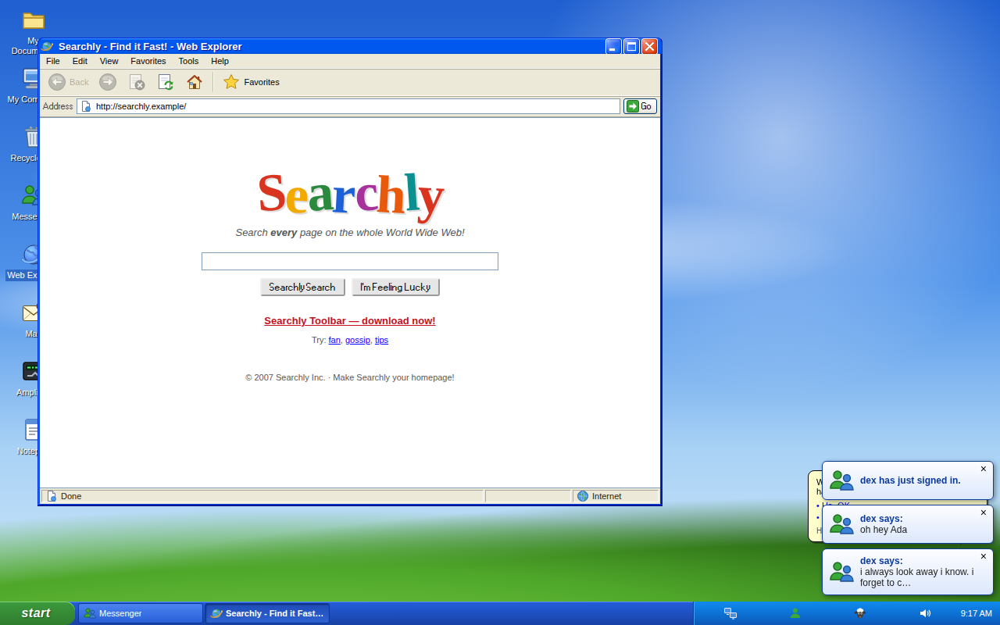 |
| **Friendspace** | **Pixlog** |
| 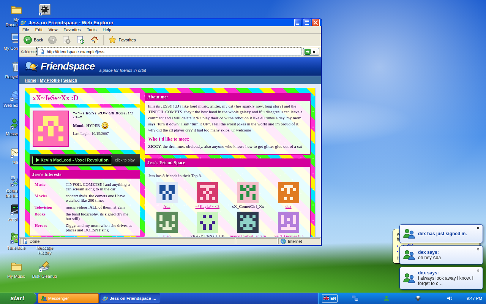 | 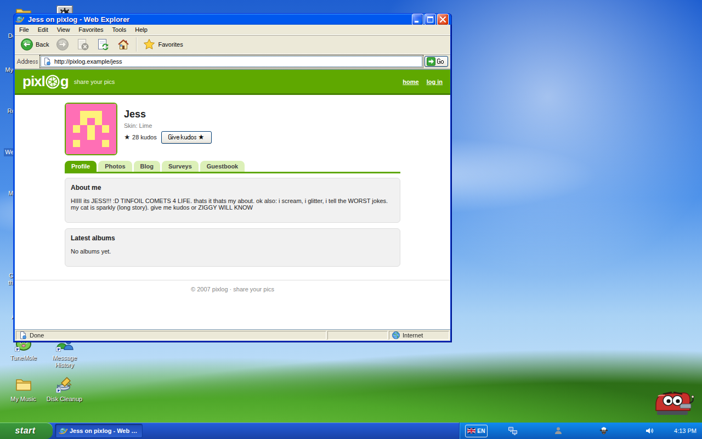 |
| **GlitterCodez** | **CheatCave** |
| 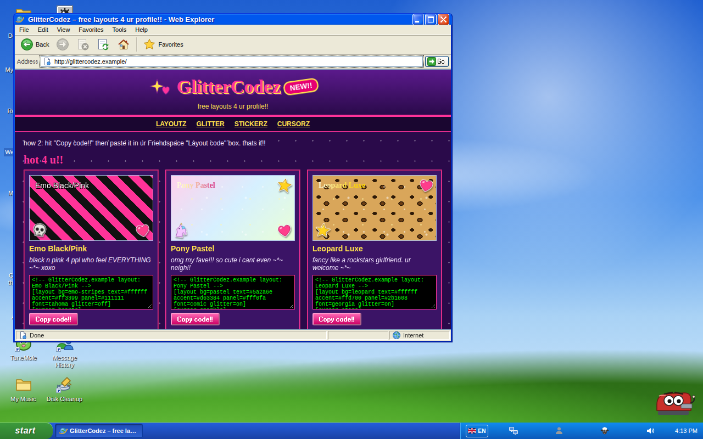 | 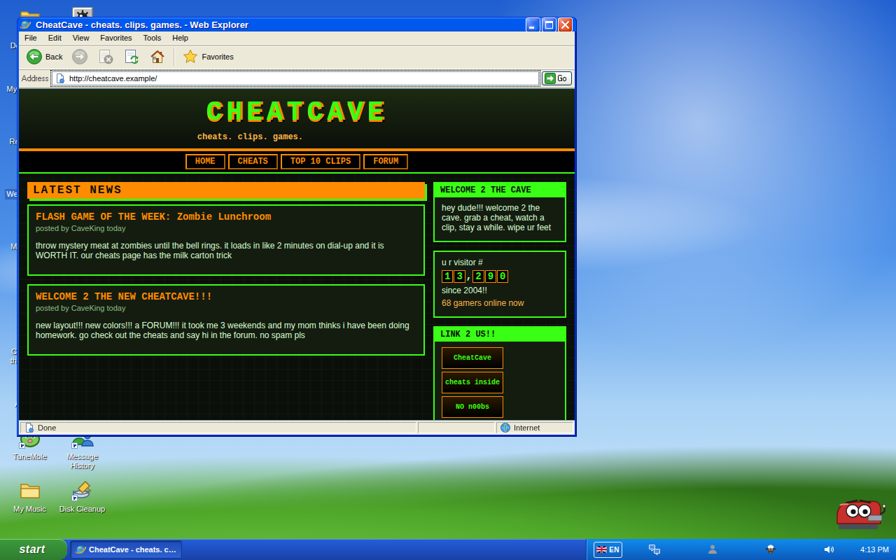 |
| **User Accounts** | **Paint** |
| 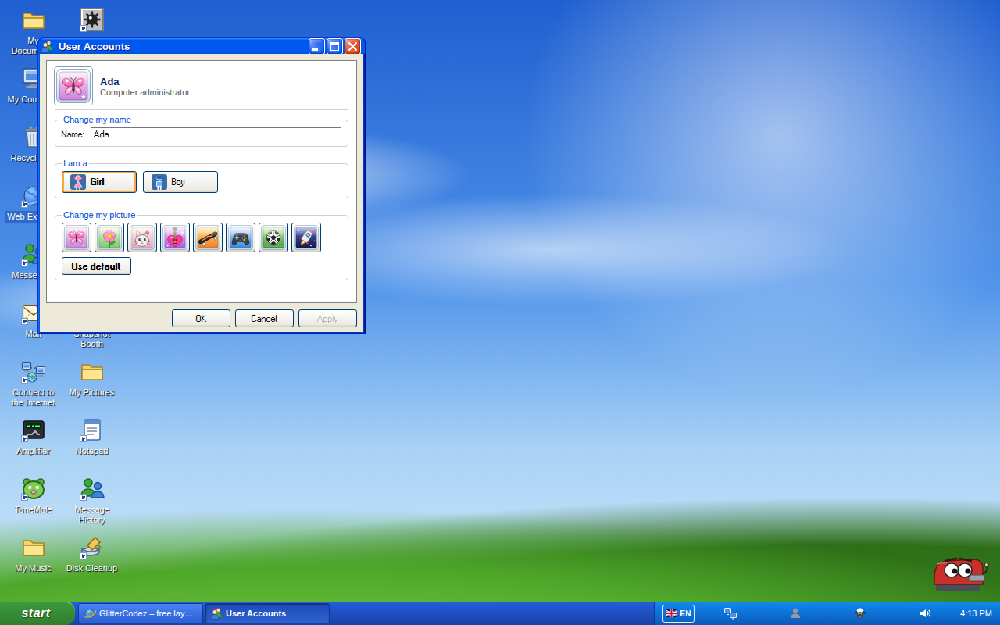 | 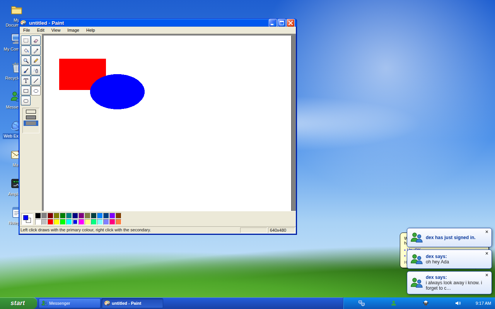 |
| **Mines** | **Hen Hunt** |
| 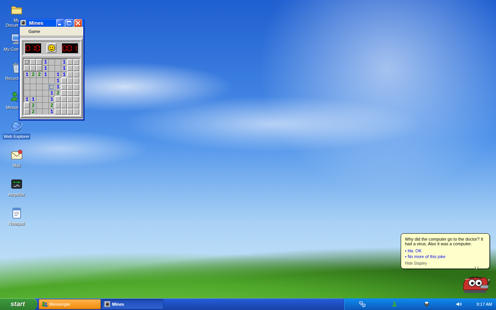 | 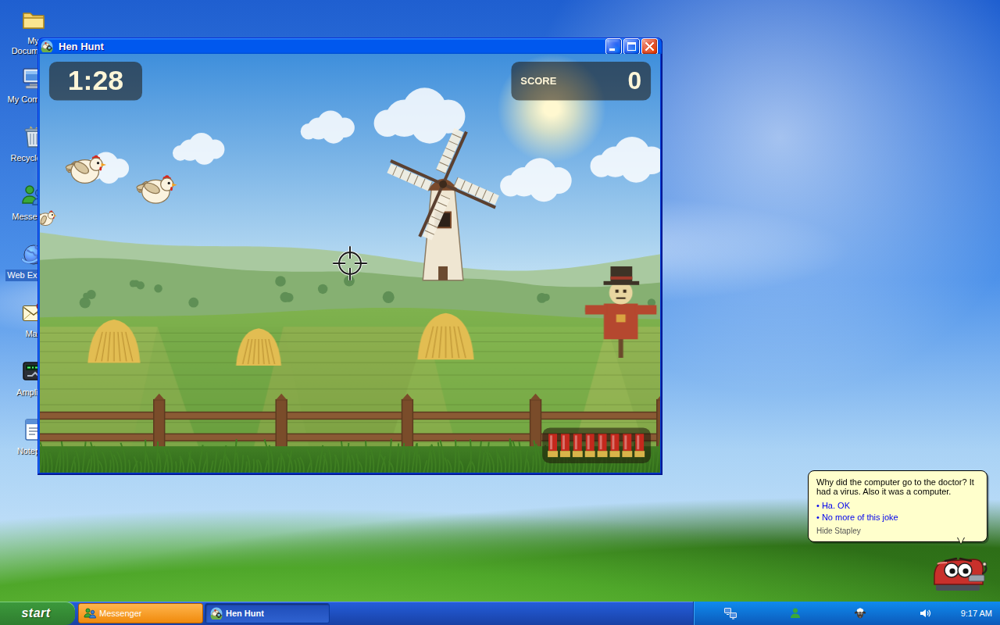 |
| **Show night, day 10** | **Poster wallpaper** |
| 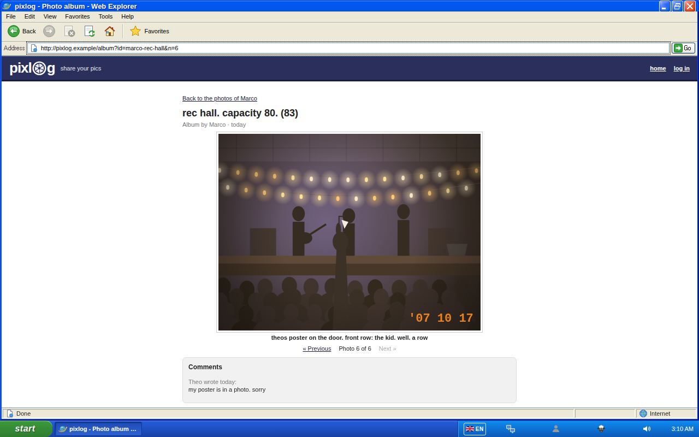 | 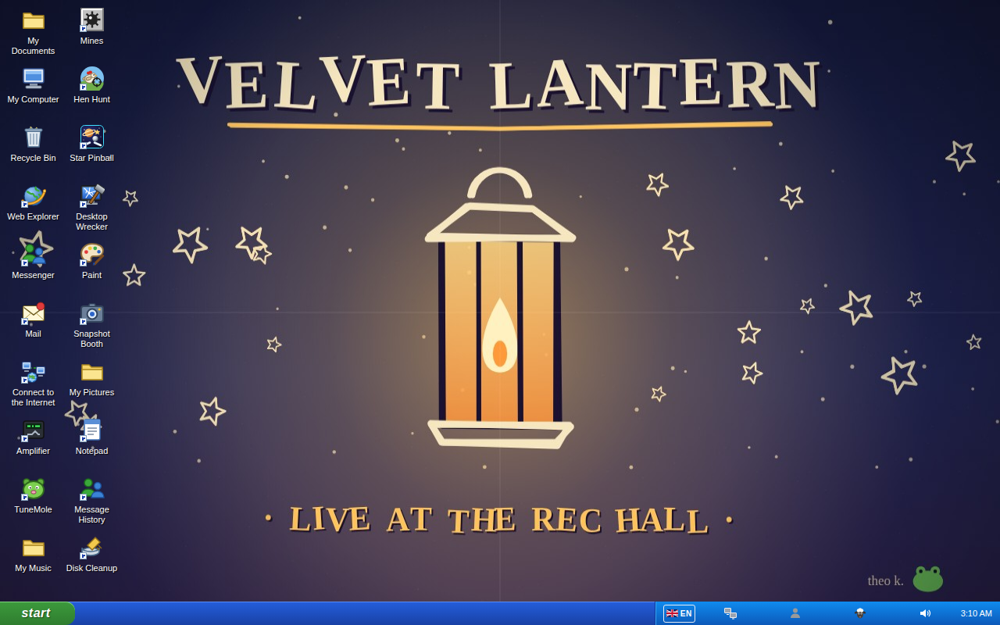 |
| **A boy-only thread** | **Day 10 mail, in German** |
| 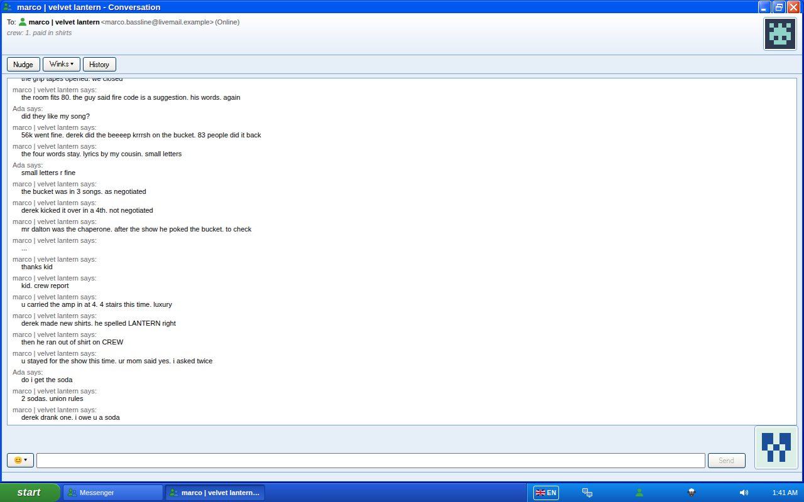 | 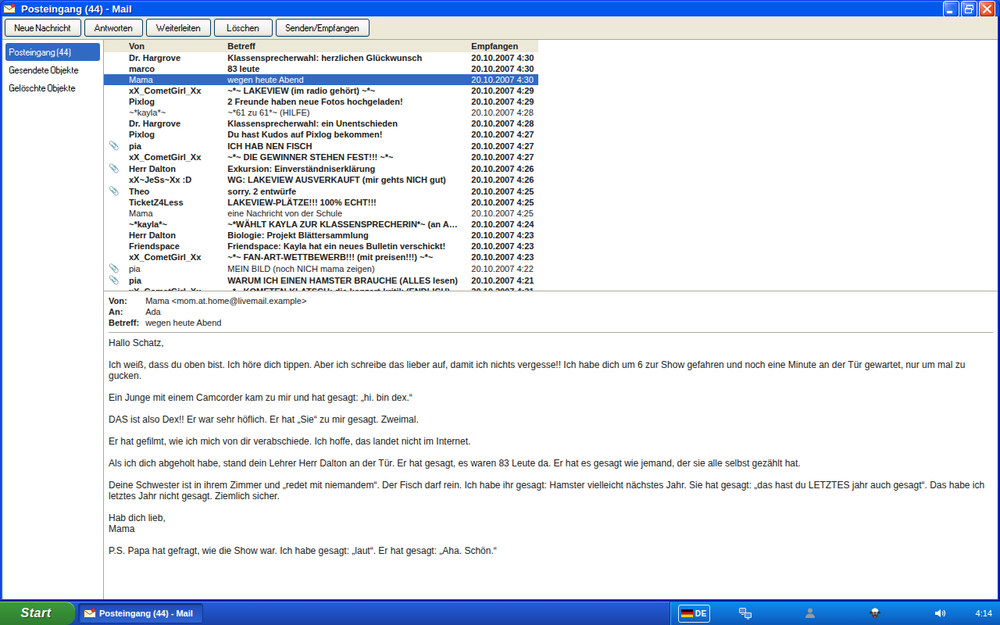 |

## Play on your phone or tablet

Open the same link on a phone or tablet. It is the same XP desktop, adapted for touch:

- **Tap** opens things (icons, menu items, list rows), **long-press** is the right-click, and a double-tap on a title bar maximizes on a tablet.
- On a **phone** every window is full screen. The taskbar has icon-only buttons, and Start → All Programs opens as a full-height panel.
- A **tablet** keeps floating windows you can drag by the title bar and resize from the edges.
- **Web Explorer** has **Fit to screen** (View menu, the phone default) to shrink 2007's fixed-width pages to your screen, and **Actual size** to scroll sideways.
- Paint draws with one finger and pans with two. Mines flags by long-press or with the 🚩 button. Pinball, Hen Hunt, Amplifier and Snapshot Booth all work by touch.
- It works in portrait and landscape, in English and German.

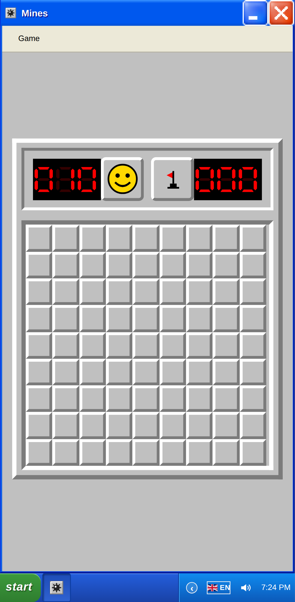

See [docs/touch.md](docs/touch.md) and [docs/architecture-v0.6.md](docs/architecture-v0.6.md) for how it works.

## Deutsch

still online is fully playable in **German** as well as English. It is not a word-for-word translation: the six friends, the mail, the websites and the files were rewritten for a German 2007 (SchülerVZ-era chat-speak, a Gymnasium instead of a US high school, euros and Fischstäbchen), with the same storylines and the same ids underneath.

- **What's localized:** the whole desktop and every app, all chats, mail, Friendspace, Pixlog, GlitterCodez, CheatCave and Kickflip Kings, Searchly and the other sites, seeded files, balloons, assistant tips, TuneMole results, and date/time/number formatting.
- **How to switch:** a German browser starts in Deutsch automatically. Otherwise pick a flag under **Language / Sprache** on the login screen, the **DE/EN** badge in the tray, or **Regional and Language Options** (*Regions- und Sprachoptionen*) in the Start menu. Switching is live, with no reload; your saves, chats and files carry over.
- **What stays as written:** things you typed or named yourself keep their language, like files on a real disk.

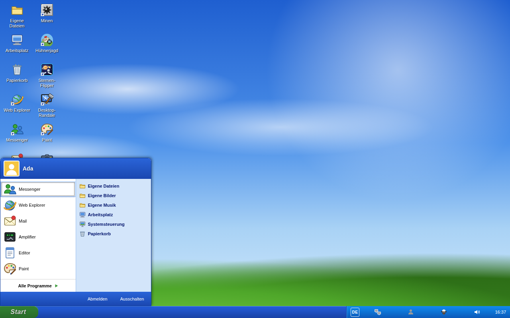

Girl and boy exist in German too, with natural forms (no gender stars).

See [docs/i18n.md](docs/i18n.md) for how it works and [docs/localization-de.md](docs/localization-de.md) for the German style guide.

## Known gaps and planned

- Content beyond day 10: stories for later days keep the day-10 state
- Friendspace, Pixlog and GlitterCodez are read-and-tweak, not social networks: you can't message strangers, upload to Pixlog beyond your own pictures, or add your own band
- German has been reviewed by the project, not by a native-speaker editor
- More friends, sites and games
- Further languages (the i18n system is built for them, see [docs/i18n.md](docs/i18n.md))

Ideas are welcome in the [issues](https://github.com/drilonrecica/still-online/issues).

## Run locally

```bash
nvm use        # Node version from .nvmrc
npm ci
npm run dev    # http://localhost:5173/still-online/
```

Other useful scripts: `npm run verify` (typecheck, lint, unit tests, build) and `npm run e2e` (Playwright; run `npx playwright install chromium` once).

## Tech stack

React 18, TypeScript, Vite, Zustand, [xp.css](https://botoxparty.github.io/XP.css/) for the window chrome, Vitest and Playwright. Everything runs client-side and is deployed to GitHub Pages. See [docs/architecture.md](docs/architecture.md) for how it fits together, [docs/architecture-v0.4.md](docs/architecture-v0.4.md) for the social sites, [docs/architecture-v0.6.md](docs/architecture-v0.6.md) for touch and [docs/gender.md](docs/gender.md) for the girl/boy content model.

## Contributing

Ideas, memories, bug reports and feedback are very welcome. [Open an issue](https://github.com/drilonrecica/still-online/issues) to share them.

## Disclaimer

still online is a fan-made, non-commercial nostalgia project. It is **not** affiliated with, endorsed by, or sponsored by Microsoft, MySpace, Netlog, Winamp, or any of their owners. All product names, logos and trademarks belong to their respective owners and are mentioned only to describe the era the project recreates. All characters, conversations and content inside the simulation are fictional.

## License

Licensed under the [Apache License 2.0](LICENSE).

Asset attributions are listed in [Credits](CREDITS.md).
